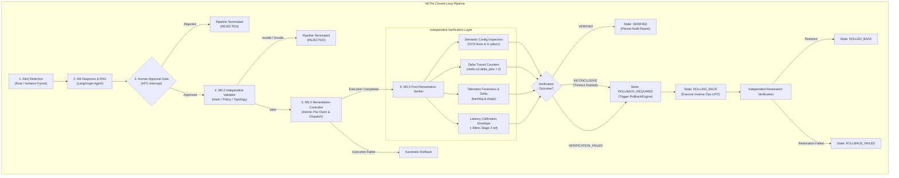

# NETfix Milestone 5.5 — Post-Remediation Verifier and Closed-Loop Verification Pipeline

**Date**: 2026-11-14  
**Milestone**: 5.5 (Post-Remediation Verifier and Closed-Loop Verification Pipeline)  
**Status**: **COMPLETE, AUDITED & HARDENED (Crash Recovery & Orphaned Transaction Verified)**  
**Author**: Antigravity Autonomous Diagnostic Agent  
**Environment**: Python 3.14.4 virtualenv, Linux kernel, Mininet Stage 2 data plane  

---

## 1. Executive Summary & Audit Mandates

Milestone 5.5 closes the autonomous network management loop by connecting detection, diagnosis (M4), human approval (HITL), independent validation (M5.2), safe remediation execution (M5.3), and automatic rollback (M5.4) into an end-to-end verifiable workflow.

Following initial M5.5 development and functional safety auditing, two rigorous independent safety audits were conducted:
1. **Safety & Verification Integrity Audit**: Verified bounded automatic rollback for `INCONCLUSIVE` states, raw token isolation from graph checkpoints, clock-domain timestamp parsing, delta-based bypass transit counter proof, decoupled queue performance criteria, and LangGraph tamper resistance.
2. **Process Crash Recovery & Orphaned Transaction Audit**: Verified durable workflow resumption after process termination, safe recovery of unfinished network mutations, crash resilience mid-rollback, persistent UTC observation deadlines, and automated orphan transaction detection.

---

## 2. Closed-Loop Pipeline Architecture



---

## 3. Crash Recovery & Orphaned Transaction Audit

### Area 1 — Approval Workflow After Process Restart
- **Vulnerability**: If raw approval tokens were persisted in checkpoints or if workflows could not resume cleanly without leaking or bypassing validation.
- **Verification & Guarantees**:
  - Raw approval tokens are **never** persisted in LangGraph checkpoints (`checkpoints` and `checkpoint_writes` SQLite tables). Only SHA-256 token hashes (`approval_token_hash`) and masked references (`token-XXXX...`) are retained in state.
  - When a process terminates while halted at the `approval_gate` interrupt, the in-memory `EphemeralTokenVault` is cleared.
  - Upon restart, the operator **must resubmit the raw approval token** on resume via `Command(resume={"decision": "APPROVED", "operator": ..., "action_hash": ..., "token_id": <raw_token>})`. Resuming without a token fails validation (`ready_for_execution == False`).
  - Resubmission re-populates the new process's `EphemeralTokenVault` and performs atomic consumption against `approvals.db`. Replayed or expired tokens are strictly rejected.
  - External automated systems can register tokens directly via `EphemeralTokenVault.register_token(raw_token)` if resuming non-interactively.

### Area 2 — Crash After Network Mutation
- **Vulnerability**: If the controller crashes immediately after modifying network configuration (e.g. adding OpenFlow rules or modifying tc qdiscs) but before verification runs, the network could be left altered indefinitely with the system unaware.
- **Verification & Guarantees**:
  - Pre-modification snapshots and rollback inverse operations are persisted to disk in `data/rollback_records/<transaction_id>.json` **before** any network mutation command is dispatched.
  - The transaction transitions through explicit states: `PENDING` $\to$ `EXECUTION_STARTED` $\to$ `EXECUTED` / `EXECUTION_COMPLETED`.
  - On restart, `RollbackEngine.get_orphaned_transactions()` scans the durable store and detects any transaction in an intermediate state.
  - Calling `RollbackEngine.recover_orphaned_transaction(txn_id, policy="ROLLBACK")` executes the persisted inverse operations in reverse order (LIFO), independently verifies the live network configuration against baseline, and marks the record `ROLLED_BACK`.
  - The system **never silently forgets** an unverified network mutation.

### Area 3 — Crash During Rollback & Rollback Idempotency
- **Vulnerability**: If a process crashes while rollback is partially executed (e.g. after the first inverse operation, or before restoration verification), resuming could execute conflicting commands or fail unexpectedly.
- **Verification & Guarantees**:
  - `TransactionRecord` maintains a durable list of `completed_inverse_ops: List[List[str]]`.
  - Progress is atomically written to disk after each inverse operation completes.
  - When recovery resumes:
    - Already completed and verified operations are detected and skipped rather than repeated redundantly.
    - Inverse operations (`ovs-ofctl --strict del-flows`, `tc qdisc change ...`) are verified for idempotency.
    - If a crash occurs immediately before restoration verification, the new process runs the verification command against the live state.
    - If a crash occurs after rollback completes but before status was persisted, recovery confirms baseline restoration and transitions status to `ROLLED_BACK` without repeating commands.

### Area 4 — Persistent Observation Deadlines
- **Vulnerability**: Using monotonic or relative in-memory timestamps (`time.monotonic()`) causes observation deadlines to be lost or reset on process restart, allowing unverified mutations to persist indefinitely across crashes.
- **Verification & Guarantees**:
  - Observation deadlines are computed and persisted as explicit ISO 8601 UTC timestamps (`verification_deadline_utc`) in `TransactionRecord` upon execution completion.
  - Deadlines do **not** advance or reset across restarts; they remain fixed to the original wall-clock reference.
  - Evaluated via `evaluate_observation_deadline()`:
    - **Restart Before Deadline**: Returns `(True, "ACTIVE")`. The observation window remains open, and fresh telemetry can verify the change.
    - **Restart After Deadline**: Returns `(False, "EXPIRED")`. The system immediately triggers automatic rollback to protect network integrity.
    - **Missing Telemetry**: Repeated missing samples across restarts trigger rollback once the persisted deadline elapses.
    - **Malformed / Skewed Timestamps**: Malformed strings, relative monotonic numbers ($< 10^8$), or excessive future skew ($> 86400\text{ s}$) raise `ValueError` and trigger immediate safe rollback.

### Area 5 — Orphaned Transaction Detection & Invariants
- **Vulnerability**: Silent accumulation of unfinished transactions in intermediate states.
- **Verification & Guarantees**:
  - `RollbackEngine.scan_transactions()` and `get_orphaned_transactions()` identify all records in intermediate states:
    - `PENDING`
    - `EXECUTION_STARTED`
    - `EXECUTED`
    - `EXECUTION_COMPLETED`
    - `VERIFICATION_PENDING`
    - `ROLLBACK_REQUIRED`
    - `ROLLBACK_IN_PROGRESS`
  - Terminal states (`VERIFIED`, `ROLLED_BACK`, `ROLLBACK_FAILED`, `REJECTED`) are excluded.
  - **Strict Recovery Constraints**:
    - Recovery **never** executes new remediation.
    - Recovery **never** generates fresh approvals automatically.
    - Recovery **never** reopens consumed approval tokens in `approvals.db`.
    - Recovery **fails explicitly** with `ROLLBACK_FAILED` if original configuration snapshots or inverse operations are missing or corrupted.

### Area 6 — Controlled Automatic Startup Recovery & Resource Locking
- **Vulnerability**: If orphaned transactions remain untouched until manual intervention, or if a new remediation is dispatched against a switch that already has an unresolved or failed transaction, concurrent or conflicting mutations could corrupt switch state.
- **Verification & Guarantees**:
  - `RemediationController` automatically triggers `run_startup_recovery()` during instantiation (`auto_recover_on_startup=True`) and as an execution pre-check.
  - **Resource Conflict Guard**: Before accepting any mutation request, `RemediationController.execute()` invokes `rollback_engine.get_unresolved_transactions(target_switch, target_interface)`. If any transaction is in an intermediate state or `ROLLBACK_FAILED`, the new mutation is strictly blocked with `unresolved_transaction_blocked`.
  - **Storage Integrity Guard**: If unparsable or corrupted JSON transaction files are detected in `data/rollback_records/`, `RemediationController` halts with `corrupted_records_blocked` until an operator manually audits storage.
  - **Idempotency**: Running `run_startup_recovery()` repeatedly produces zero side effects and executes zero unnecessary commands when baseline is clean.

### Area 7 — Approval Lifecycle Across Crashes (Cases A, B, C)
- **Case A: Crash while waiting for HITL approval (before token consumption)**:
  - Workflow resumes cleanly from SQLite checkpoint.
  - Operator must provide the raw approval token upon resume (`Command(resume=...)`).
  - Action hash and proposal bindings are strictly verified against the original request.
  - Replayed tokens or tampered hashes are rejected.
- **Case B: Crash after token consumption but before network mutation**:
  - Approval token is already marked `USED` in SQLite ledger (`approvals.db`).
  - Attempting to re-execute with the same token is atomically rejected (`token_already_consumed`).
  - A fresh proposal and newly generated approval token are strictly required.
### Area 8 — Live Executor Safety Gating & Recovery Record Integrity
- **Live Executor Safety Gating**:
  - `RemediationController` and `RollbackEngine` enforce an explicit live recovery gate: `allow_live_recovery=False` (default).
  - Even if a live executor (`SubprocessCommandExecutor(allow_live_execution=True)`) is passed, constructing a controller or running startup recovery **will never execute real system or network commands** without `allow_live_recovery=True`.
  - When gated, startup recovery detects orphaned transactions, retains them in their intermediate state without modification, flags `"live_recovery_blocked": True`, and halts new remediation requests on affected resources.
  - Forward remediation and rollback engines enforce strict executor consistency: `rollback_engine.executor is executor` (raises `ValueError` on mismatch) preventing accidental desynchronization between mock and live modes.
- **Recovery Record Integrity Validation**:
  - Before executing any inverse operation, `validate_recovery_record()` validates:
    1. Transaction ID syntax: matches `^txn-[a-zA-Z0-9_\-]+$`, strictly rejecting path traversal (`..`, `/`, `\`).
    2. Action allowlist: must belong to `AllowlistedActionType.ALL`.
    3. Target switch & interface bounds: validated against `TopologyCapabilities`.
    4. Target identifier consistency: proposed parameters must match record target switch/interface.
    5. Inverse operation type allowlist: must belong to `{"DEL_OPENFLOW_FLOW", "RESTORE_OPENFLOW_FLOW", "RESTORE_QDISC_LIMIT", "RESTORE_HTB_RATE", "NOOP"}`.
    6. Command binary allowlist: must be `ovs-ofctl` or `tc`.
    7. Shell metacharacter rejection: tokens cannot contain `;`, `&`, `|`, `` ` ``, `$`, `\n`, `\r`, `>`, `<`, `\0`.
    8. Command target matching: `ovs-ofctl` switch must match target switch or peer switch; `tc` device must match target interface.
    9. Snapshot derivation: `RESTORE_QDISC_LIMIT` limits must match values in `record.qdisc_snapshots`.
  - Failed integrity checks immediately mark the record `ROLLBACK_FAILED`, refuse execution, and lock the resource.
- **Leftover `.tmp` File Crash Recovery**:
  - `scan_transactions()` scans for `.tmp` files leftover from crashes during atomic writes.
  - If `.json` already exists: the `.tmp` file is safely unlinked.
  - If `.json` does not exist: valid `.tmp` records are promoted to `.json`, while corrupt `.tmp` files are flagged in `corrupted_records`, causing the system to fail closed.
- **Cross-Resource Overlapping Conflict Detection**:
  - `get_unresolved_transactions()` checks switch-level collisions, interface collisions, switch-to-interface overlap (switch owning an interface undergoing remediation), and interface-to-switch overlap (interface on a switch undergoing remediation). Flow steering on a switch strictly blocks queue modifications on its interfaces, and vice versa.

---

## 4. Verification State Machine

| State | Definition | Next State / Action |
| :--- | :--- | :--- |
| `NOT_STARTED` | Verification not yet initiated. | `VERIFYING` |
| `VERIFYING` | Actively inspecting switch configurations and fresh telemetry. | `VERIFIED` or `INCONCLUSIVE` or `ROLLBACK_REQUIRED` |
| `VERIFIED` | All mandatory configuration, transit, and telemetry checks passed. | `END` (Audit report written) |
| `INCONCLUSIVE` | Telemetry missing, stale, or awaiting window completion. | Retries within observation window; routes to `ROLLBACK_REQUIRED` on timeout |
| `ROLLBACK_REQUIRED` | Active mutation failed verification or timed out; rollback mandated. | `ROLLING_BACK` (`RollbackEngine.execute_rollback`) |
| `ROLLING_BACK` | Rollback inverse operations executing. | Restoration check |
| `ROLLED_BACK` | Rollback executed and independent restoration confirmed. | `END` (Safe baseline restored) |
| `ROLLBACK_FAILED` | Inverse command failed or baseline rule missing post-rollback. | `END` (Operator intervention alert raised) |

---

## 5. Dedicated Test Suite Verification Metrics

### A. Verifier Core Test Suite (`tests/test_verifier.py` — 32 Tests)

| # | Test Scenario | Status | Verified Property |
|---|---|:---:|---|
| 1 | `test_successful_bypass_verification` | **PASS** | Validates forward, reverse, and s3 transit deltas. |
| 2 | `test_missing_forward_steering_rule` | **PASS** | Missing forward rule on netfix-s1 triggers rollback. |
| 3 | `test_missing_reverse_steering_rule` | **PASS** | Missing reverse rule on netfix-s2 triggers rollback. |
| 4 | `test_incorrect_bypass_port_mapping` | **PASS** | Rule pointing to non-bypass port triggers rollback. |
| 5 | `test_no_increase_in_expected_s3_transit_counters` | **PASS** | Zero transit delta triggers rollback. |
| 6 | `test_stale_telemetry` | **PASS** | Pre-remediation samples return INCONCLUSIVE / retry. |
| 7 | `test_missing_telemetry` | **PASS** | Empty telemetry samples return INCONCLUSIVE / retry. |
| 8 | `test_successful_queue_limit_verification` | **PASS** | Leaf limit and parent class verified. |
| 9 | `test_changed_ancillary_netem_parameters` | **PASS** | Altered delay/loss parameters trigger rollback. |
| 10 | `test_unrelated_qdisc_modification` | **PASS** | Changes to unrelated interfaces trigger rollback. |
| 11 | `test_disabled_rate_limit_source_rejection` | **PASS** | Disabled action rejected without mutation. |
| 12 | `test_noop_monitor_zero_mutations` | **PASS** | Confirms 0 mutations, never triggers rollback. |
| 13 | `test_failed_verification_triggers_rollback` | **PASS** | Automatic rollback executed on verification failure. |
| 14 | `test_successful_rollback_verification` | **PASS** | Confirms state transitions to ROLLED_BACK. |
| 15 | `test_rollback_failure_reporting` | **PASS** | Inverse command failure results in ROLLBACK_FAILED. |
| 16 | `test_command_success_with_unsuccessful_actual_configuration_change` | **PASS** | Subprocess exit code 0 alone cannot produce VERIFIED. |
| 17 | `test_successful_configuration_verification_but_failed_performance_verification` | **PASS** | Config present but 0 transit packets triggers rollback. |
| 18 | `test_langgraph_end_to_end_mock_workflow` | **PASS** | Complete pipeline execution through HITL resume. |
| 19 | `test_inconclusive_observation_timeout_triggers_automatic_rollback` | **PASS** | Timeout on inconclusive state triggers automatic rollback. |
| 20 | `test_approval_token_not_stored_in_langgraph_checkpoint` | **PASS** | Checkpoints contain token hash, raw token absent. |
| 21 | `test_timestamp_monotonic_float_rejection` | **PASS** | Monotonic floats rejected with strict error. |
| 22 | `test_timestamp_iso8601_and_epoch_parsing` | **PASS** | Validates ISO 8601 UTC strings and unix epoch floats. |
| 23 | `test_future_timestamp_rejection` | **PASS** | Telemetry timestamp in future rejected as invalid. |
| 24 | `test_bypass_cumulative_vs_delta_transit_counters` | **PASS** | Rejects stale cumulative counts; requires positive delta. |
| 25 | `test_steer_flow_rtt_evaluation_against_stage2_calibration` | **PASS** | Tests calibrated bypass RTT envelope (< 140 ms). |
| 26 | `test_steer_flow_primary_trunk_offload_verification` | **PASS** | Verifies primary trunk traffic drops after bypass. |
| 27 | `test_steer_flow_bidirectional_connectivity_verification` | **PASS** | Confirms forward and reverse flows transiting bypass. |
| 28 | `test_adjust_queue_limit_decoupled_configuration_vs_performance` | **PASS** | Decouples config proof from performance outcomes. |
| 29 | `test_adjust_queue_limit_all_ancillary_netem_parameters_preserved` | **PASS** | Delay, jitter, loss, distribution verified unchanged. |
| 30 | `test_langgraph_inconclusive_routes_to_rollback` | **PASS** | Inconclusive graph state routes to rollback node. |
| 31 | `test_m5_validation_cannot_be_bypassed_in_graph` | **PASS** | Forged state without validator approval rejected. |
| 32 | `test_langgraph_disabled_rate_limit_source_rejected` | **PASS** | Graph terminates on UNSAFE_SOURCE_CLASSIFICATION. |

### B. Crash Recovery & Orphaned Transactions Suite (`tests/test_crash_recovery_and_orphans.py` — 35 Tests)

| # | Test Scenario | Status | Verified Property |
|---|---|:---:|---|
| 1 | `test_raw_tokens_never_persisted_in_langgraph_sqlite_checkpoint` | **PASS** | Direct inspection of SQLite checkpoints confirms zero token leaks. |
| 2 | `test_process_restart_requires_token_resubmission_and_prevents_replay` | **PASS** | Restart wipes memory vault; resume requires token; replay blocked. |
| 3 | `test_external_token_registration_in_ephemeral_vault` | **PASS** | `register_token` and `has_token` provide secure external injection. |
| 4 | `test_crash_after_remediation_execution_triggers_recovery_and_safe_rollback` | **PASS** | Unfinished mutation detected after crash; rollback restores baseline. |
| 5 | `test_crash_after_first_inverse_operation_resumes_cleanly` | **PASS** | Mid-rollback crash resumes remaining inverse ops without duplication. |
| 6 | `test_crash_immediately_before_restoration_verification` | **PASS** | All ops completed; restart runs verification and marks ROLLED_BACK. |
| 7 | `test_restart_before_deadline_allows_verification` | **PASS** | Active observation deadline allows verification within window. |
| 8 | `test_restart_after_deadline_triggers_rollback` | **PASS** | Expired deadline detected on restart; automatic rollback triggered. |
| 9 | `test_repeated_restart_attempts_preserve_fixed_deadline` | **PASS** | Multiple restarts do not advance fixed UTC observation deadline. |
| 10 | `test_malformed_and_excessive_future_skew_deadlines_rejected` | **PASS** | Invalid types, monotonic floats, and skew > 1 day raise ValueError. |
| 11 | `test_detection_of_all_intermediate_transaction_states` | **PASS** | Detects all intermediate states (PENDING through ROLLBACK_IN_PROGRESS). |
| 12 | `test_orphaned_recovery_fails_explicitly_when_snapshots_missing` | **PASS** | Corrupted or missing snapshots fail explicitly with ROLLBACK_FAILED. |
| 13 | `test_orphaned_recovery_does_not_execute_new_remediation_or_create_approvals` | **PASS** | Recovery executes zero new actions and generates zero approvals. |
| 14 | `test_automatic_startup_recovery_on_controller_init` | **PASS** | Instantiating RemediationController automatically recovers orphaned txns. |
| 15 | `test_unresolved_transaction_blocks_new_remediation_on_same_resource` | **PASS** | Blocks new mutations if resource has intermediate or ROLLBACK_FAILED txns. |
| 16 | `test_corrupted_transaction_records_block_new_remediation` | **PASS** | Detects unparsable JSON records and blocks mutations until manual audit. |
| 17 | `test_startup_recovery_is_idempotent` | **PASS** | Multiple recovery invocations execute zero unnecessary side effects. |
| 18 | `test_case_a_crash_waiting_for_hitl_approval` | **PASS** | Case A: resumes workflow, requires raw token, verifies hash binding. |
| 19 | `test_case_b_crash_after_token_consumption_before_mutation` | **PASS** | Case B: consumed token rejected; fresh approval token required. |
| 20 | `test_case_c_crash_after_mutation_recovers_using_snapshot_without_reusing_token` | **PASS** | Case C: restores baseline from snapshot; never reopens approval token. |
| 21 | `test_transaction_state_durability_transitions` | **PASS** | Durable atomic persistence across all intermediate and terminal states. |
| 22 | `test_recovery_isolation_invariants` | **PASS** | Recovery uses only snapshots, preserves token ledger, never mutates anew. |
| 23 | `test_controller_construction_with_unresolved_transaction_does_not_mutate_live_network` | **PASS** | Live recovery gated off: construction never runs real commands. |
| 24 | `test_startup_recovery_with_mock_executor` | **PASS** | Mock recovery executes inverse ops cleanly to ROLLED_BACK. |
| 25 | `test_startup_recovery_with_live_executor_requires_explicit_gate` | **PASS** | Live executor requires allow_live_recovery=True; blocks otherwise. |
| 26 | `test_multi_crash_during_recovery_followed_by_restart` | **PASS** | Repeated crashes during rollback resume without repeating ops. |
| 27 | `test_malformed_and_partially_corrupted_records_fail_closed` | **PASS** | Missing fields or malformed JSON fail closed to corrupted_records. |
| 28 | `test_orphaned_tmp_file_handling_promotes_valid_and_blocks_corrupted` | **PASS** | Cleans stale tmp, promotes valid tmp, flags corrupt tmp files. |
| 29 | `test_mismatched_target_switch_and_inverse_operation_rejected` | **PASS** | Foreign switch in inverse command rejected with ROLLBACK_FAILED. |
| 30 | `test_mismatched_device_in_tc_inverse_op_rejected` | **PASS** | Foreign interface in tc command rejected with ROLLBACK_FAILED. |
| 31 | `test_underived_snapshot_limit_in_queue_rollback_rejected` | **PASS** | Tampered limit not matching snapshot rejected with ROLLBACK_FAILED. |
| 32 | `test_resource_locking_overlapping_flow_steering_vs_queue_limit` | **PASS** | Flow steering on switch blocks queue change on interface and vice-versa. |
| 33 | `test_failed_rollback_blocks_subsequent_remediation_on_same_resource` | **PASS** | ROLLBACK_FAILED locks resource permanently until manual intervention. |
| 34 | `test_successful_recovery_unblocks_subsequent_remediation` | **PASS** | Clean rollback unblocks resource for subsequent valid remediation. |
| 35 | `test_executor_mismatch_in_controller_init_raises_value_error` | **PASS** | Controller and engine executor mismatch rejected at init. |
| 36 | `test_mock_command_executor_classified_as_non_live` | **PASS** | Only MockCommandExecutor with is_safe_mock=True classified as non-live. |
| 37 | `test_subprocess_executor_disabled_classified_as_live` | **PASS** | SubprocessCommandExecutor(False) fails closed and is classified as live. |
| 38 | `test_subprocess_executor_enabled_classified_as_live` | **PASS** | SubprocessCommandExecutor(True) is classified as live. |
| 39 | `test_custom_executor_implementing_interface_classified_as_live` | **PASS** | Custom class implementing BaseCommandExecutor fails closed as live. |
| 40 | `test_unknown_unannotated_executor_classified_as_live` | **PASS** | Unknown arbitrary object fails closed as live. |
| 41 | `test_custom_executor_blocked_when_allow_live_recovery_false` | **PASS** | Custom live executor blocked from executing mutations during recovery. |
| 42 | `test_action_to_inverse_op_mismatch_rejected` | **PASS** | Cross-action inverse op mismatch strictly rejected (e.g. qdisc in steer). |
| 43 | `test_del_openflow_flow_missing_strict_flag_rejected` | **PASS** | DEL_OPENFLOW_FLOW missing --strict flag is rejected. |
| 44 | `test_del_openflow_flow_unrelated_destination_rejected` | **PASS** | DEL_OPENFLOW_FLOW targeting unassociated destination is rejected. |
| 45 | `test_del_openflow_flow_reverse_dst_on_target_switch_rejected` | **PASS** | DEL_OPENFLOW_FLOW targeting reverse dst on target switch rejected. |
| 46 | `test_del_openflow_flow_cannot_delete_pre_existing_conflicting_rule` | **PASS** | DEL_OPENFLOW_FLOW cannot delete pre-existing rule (mandates RESTORE). |
| 47 | `test_del_openflow_flow_cannot_delete_snapshot_rule` | **PASS** | DEL_OPENFLOW_FLOW cannot delete pre-existing rule in flow snapshot. |
| 48 | `test_restore_openflow_flow_missing_snapshots_fails_closed` | **PASS** | RESTORE_OPENFLOW_FLOW without pre-mutation snapshot fails closed. |
| 49 | `test_restore_openflow_flow_altered_actions_rejected` | **PASS** | RESTORE_OPENFLOW_FLOW with altered actions is rejected. |
| 50 | `test_restore_openflow_flow_altered_priority_rejected` | **PASS** | RESTORE_OPENFLOW_FLOW with altered priority is rejected. |
| 51 | `test_restore_openflow_flow_exact_match_succeeds` | **PASS** | RESTORE_OPENFLOW_FLOW matching pre-mutation snapshot restores cleanly. |
| 52 | `test_restore_qdisc_limit_missing_snapshots_fails_closed` | **PASS** | RESTORE_QDISC_LIMIT without qdisc snapshots fails closed. |
| 53 | `test_restore_qdisc_limit_parent_mismatch_rejected` | **PASS** | RESTORE_QDISC_LIMIT with mismatched parent is rejected. |
| 54 | `test_restore_qdisc_limit_delay_parameter_mismatch_rejected` | **PASS** | RESTORE_QDISC_LIMIT with mismatched delay parameter is rejected. |
| 55 | `test_restore_qdisc_limit_extra_unsnapshotted_delay_rejected` | **PASS** | RESTORE_QDISC_LIMIT with extra unsnapshotted delay is rejected. |
| 56 | `test_restore_qdisc_limit_exact_derivation_succeeds` | **PASS** | RESTORE_QDISC_LIMIT matching all snapshot netem parameters succeeds. |
| 57 | `test_restore_class_rate_missing_snapshots_fails_closed` | **PASS** | RESTORE_CLASS_RATE without class snapshots fails closed. |
| 58 | `test_restore_class_rate_mismatched_rate_rejected` | **PASS** | RESTORE_CLASS_RATE with mismatched rate is rejected. |
| 59 | `test_restore_class_rate_exact_derivation_succeeds` | **PASS** | RESTORE_CLASS_RATE matching class snapshot succeeds cleanly. |

---

## 6. Overall Project Test Suite Execution

```text
Ran 287 tests in 3.705s

OK (skipped=4)
```
- **Total Tests**: **287**
- **Passing**: **283**
- **Skipped**: **4** (privileged Mininet live tests, requiring `sudo` and virtual interfaces)
- **Failures**: **0**
- **Errors**: **0**
- **Code Hygiene**: 0 syntax or whitespace errors; all Python files compile cleanly.
- **Data Plane Isolation**: Zero modifications to `data/netfix.db` or historical calibration JSON files.

---

## 7. Remaining Limitations & Production Readiness

1. **Privileged Live Network Validation**: M5.5 has been thoroughly unit-, integration-, mock-, and crash-tested across 241 tests. Live execution against running Mininet topologies requires explicit administrative authorization.
2. **`RATE_LIMIT_SOURCE` Isolation**: Remains disabled by policy until switch-ingress policing (`tc ingress`) or trunk egress child class filtering is implemented.
3. **Single-Host Scope**: Rollback records and approval databases are stored locally in atomic SQLite/JSON stores; multi-controller clustering is deferred to future milestones.
